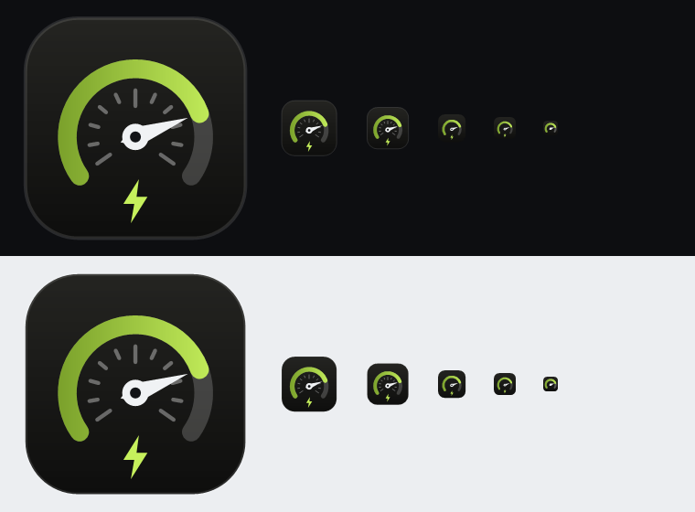
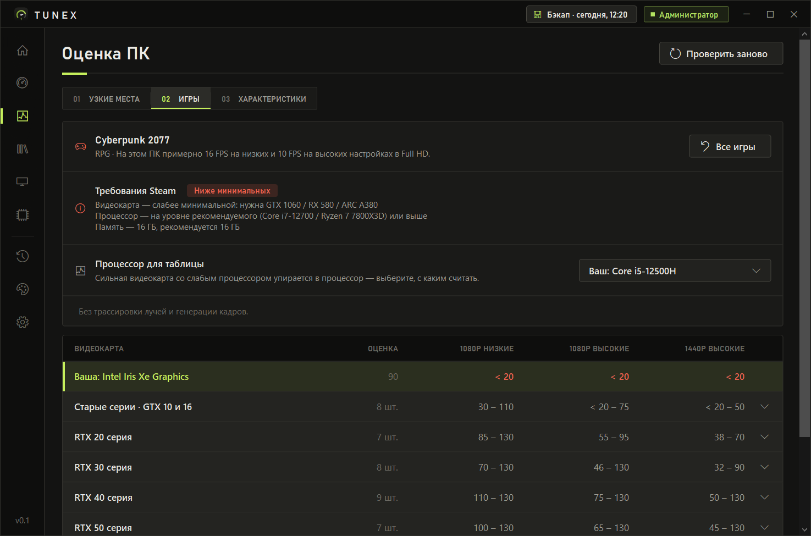

# Tunex

Настройка Windows для игр. Каждое изменение можно отменить.

## Скачать

Последняя версия — на странице [Releases](https://github.com/MarlenGO/Tunex/releases/latest), файл `Tunex.exe`. Установка не нужна.

Если Windows покажет «Система Windows защитила ваш компьютер», нажмите «Подробнее» → «Выполнить в любом случае». Для части настроек нужен запуск от имени администратора.

Требуется Windows 10 или 11. Обновления устанавливаются автоматически, это можно отключить в настройках.

## Разделы

- **Главная** — состояние системы, загрузка и температура.
- **Оптимизация** — электропитание, игровые настройки Windows, службы, сеть.
- **Оценка ПК** — узкие места, требования игр из Steam, примерный FPS по видеокартам.
- **Игры** — настройки запуска для отдельных игр.
- **Экран** — яркость, контраст и частота обновления монитора.
- **NVIDIA** — настройки видеокарты и оверлеев.
- **Журнал** — история изменений с возможностью отмены.
- **Бэкапы** — сохранение и восстановление всех настроек.
- **Оформление** и **Настройки** — цвет интерфейса и автообновление.

## Скриншоты

| | |
|---|---|
|  |  |
|  |  |

## Конфиденциальность

Tunex не собирает данные. В интернет обращается только к Steam (требования игр) и GitHub (обновления).

## Стек

C#, .NET Framework 4.8, Windows Forms, WinAPI, WMI. Сборка — `csc.exe`, без сторонних библиотек. Подробнее — [docs/DEVELOPMENT.md](docs/DEVELOPMENT.md).
