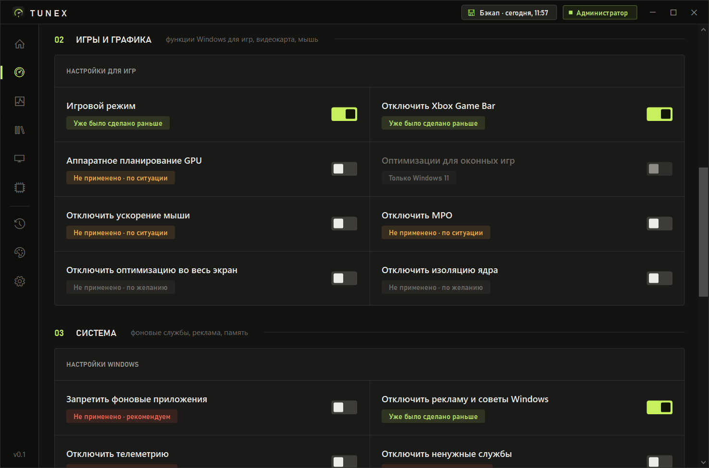
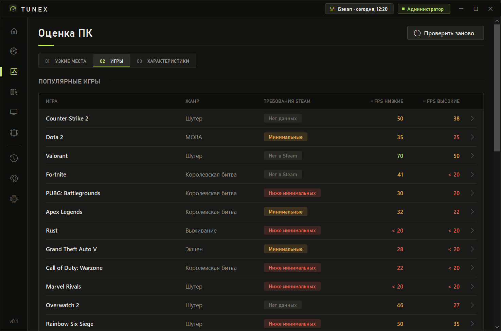
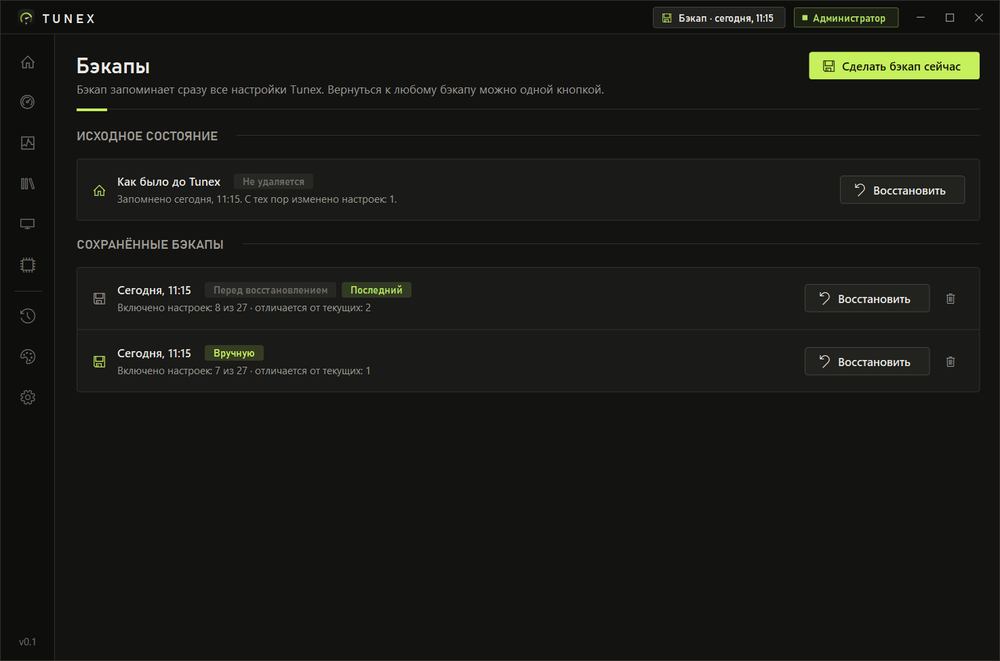
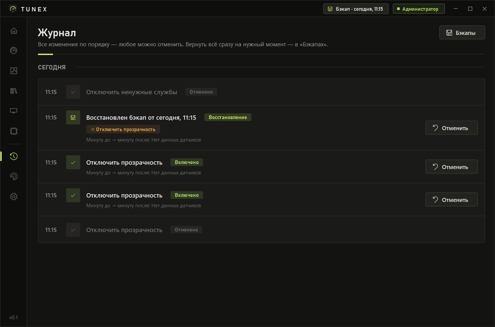
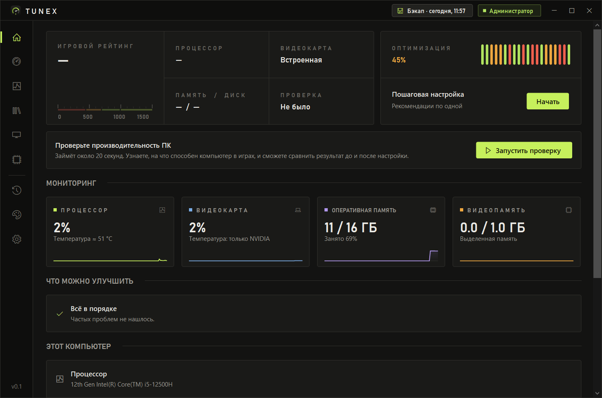
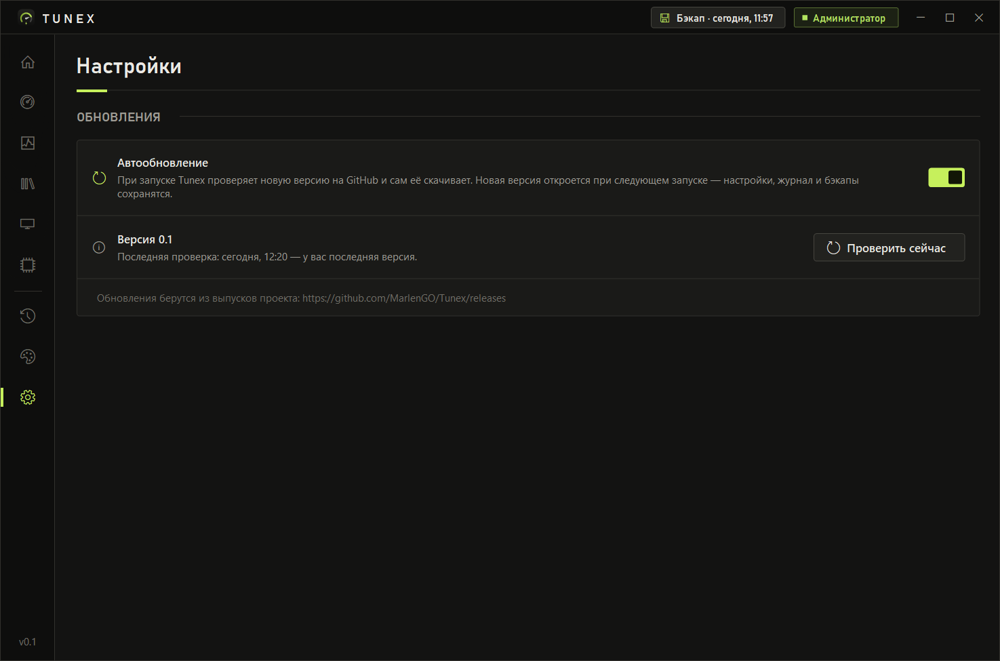

# Tunex

**Настройка Windows для игр — понятно, безопасно и с возможностью всё вернуть**

Tunex — небольшая программа для Windows, которая убирает то, что мешает играм: лишние фоновые службы, «экономичное» электропитание, Xbox Game Bar, ускорение мыши и другое. Каждая настройка объяснена простыми словами, включается одним переключателем и в любой момент возвращается обратно.

## 📥 Как скачать и запустить

1. Откройте страницу **[последней версии](https://github.com/MarlenGO/Tunex/releases/latest)**.
2. В блоке **Assets** нажмите **`Tunex.exe`** — файл скачается.
3. Запустите `Tunex.exe`. Устанавливать ничего не нужно: это один файл, его можно положить в любую папку.
4. Если Windows покажет синее окно **«Система Windows защитила ваш компьютер»** — нажмите **«Подробнее» → «Выполнить в любом случае»**. Так Windows реагирует на любую программу без платной цифровой подписи.
5. Для части настроек (службы, сеть, электропитание) нужны права администратора: нажмите правой кнопкой на `Tunex.exe` → **«Запуск от имени администратора»** или кнопку «Без прав администратора» в самой программе.

**Требования:** Windows 10 или 11. Всё остальное (.NET Framework 4.8) уже встроено в Windows.

**Обновления** приходят сами: Tunex проверяет новую версию на GitHub и тихо её скачивает — новая версия откроется при следующем запуске. Отключается в разделе «Настройки».

## ✨ Возможности

### ⚡ Оптимизация
- **Электропитание** — схема «Максимальная производительность», минимальная частота процессора, парковка ядер, энергосбережение PCIe и USB.
- **Игры и графика** — игровой режим, Xbox Game Bar, аппаратное планирование GPU, оптимизация оконных игр, ускорение мыши, MPO, полноэкранная оптимизация, изоляция ядра.
- **Система** — фоновые приложения, реклама и советы Windows, телеметрия, ненужные службы, SysMain, индексирование, файл подкачки, прозрачность, приоритет игр (MMCSS).
- **Сеть** — энергосбережение сетевой карты (EEE), оптимизация доставки, ограничение сетевого трафика.
- У каждой настройки — понятное описание, рекомендация («рекомендуем», «по ситуации», «по желанию») и статус: применено ли и кем.

### 🎮 Игры
- **Свои игры** — Tunex запускает их на мощной видеокарте, с высоким приоритетом и в «честном» полноэкранном режиме.
- **Во время игры** — понижает приоритет фоновых программ и освобождает память, пока игра запущена.

### 🖥 Оценка ПК
- **Узкие места** — одноканальная память, память ниже своей частоты, Windows на HDD, мало места на диске, монитор не на максимальной частоте, старый драйвер видеокарты, «экономная» схема питания. Многое исправляется кнопкой.
- **Игры и FPS** — 20 популярных игр с примерным FPS на вашем ПК и сравнением с системными требованиями из Steam.
- **Таблица FPS** — для каждой игры: FPS на десятках видеокарт от GTX 10 до RTX 50, Radeon и Intel Arc, в Full HD и 1440p, с выбором процессора.
- **Свои игры Steam** — Tunex сам находит установленные игры и сравнивает их требования с вашим ПК. Если данных нет — честно пишет «нет данных», а не угадывает.

### 🛡 Безопасность
- **Бэкапы** — снимок всех настроек одной кнопкой; «Как было до Tunex» запоминается при первом запуске. Автоматический бэкап раз в день перед изменениями и перед каждым восстановлением.
- **Журнал** — каждое изменение с временем, любое можно отменить. Через минуту после изменения видно, как изменились загрузка и температура.

### 🧩 Ещё
- **Экран** — яркость и контраст монитора прямо из Windows (DDC/CI), гамма, частота обновления.
- **NVIDIA и Discord** — отключение аппаратного ускорения Discord, подсказки по оверлеям NVIDIA и Discord.
- **Проверка производительности** — тест процессора, памяти и диска с игровым рейтингом.
- **Мониторинг** — загрузка процессора, видеокарты, памяти и температура.
- **Оформление** — три готовых цвета акцента или свой.

## 📸 Скриншоты

| Игры и требования Steam | Таблица FPS по видеокартам |
|---|---|
|  |  |
| **Бэкапы** | **Журнал изменений** |
|  |  |
| **Главная** | **Настройки и автообновление** |
|  |  |

## 🔒 Что Tunex делает и чего не делает

- Меняет только настройки Windows, описанные в программе, и запоминает, как было до изменения.
- Не собирает и никуда не отправляет данные о вас и вашем компьютере.
- В интернет обращается только в двух случаях: к **Steam** — за системными требованиями игры (отправляется только номер игры или название из поиска) и к **GitHub** — за новой версией программы.
- FPS в таблицах — **примерная оценка** по типичным результатам обзоров, а не замер на вашем ПК.

## 🛠 Стек

| | |
|---|---|
| Язык | **C# 5** |
| Платформа | **.NET Framework 4.8** (встроен в Windows 10/11) |
| Интерфейс | **Windows Forms**, все элементы нарисованы вручную (GDI+), тёмная тема |
| Система | **WinAPI** (P/Invoke), **WMI**, реестр, службы Windows, `powercfg`, **DDC/CI** для мониторов |
| Данные | **Steam Store API** (требования игр), **GitHub Releases API** (обновления), JSON |
| Сборка | встроенный в Windows компилятор `csc.exe` — без Visual Studio и NuGet, без сторонних библиотек |

Как собрать из исходников, устроен код и выпустить новую версию — в **[docs/DEVELOPMENT.md](docs/DEVELOPMENT.md)**.

## 💬 Обратная связь

Нашли ошибку или есть идея — откройте **[Issue](https://github.com/MarlenGO/Tunex/issues)**.
